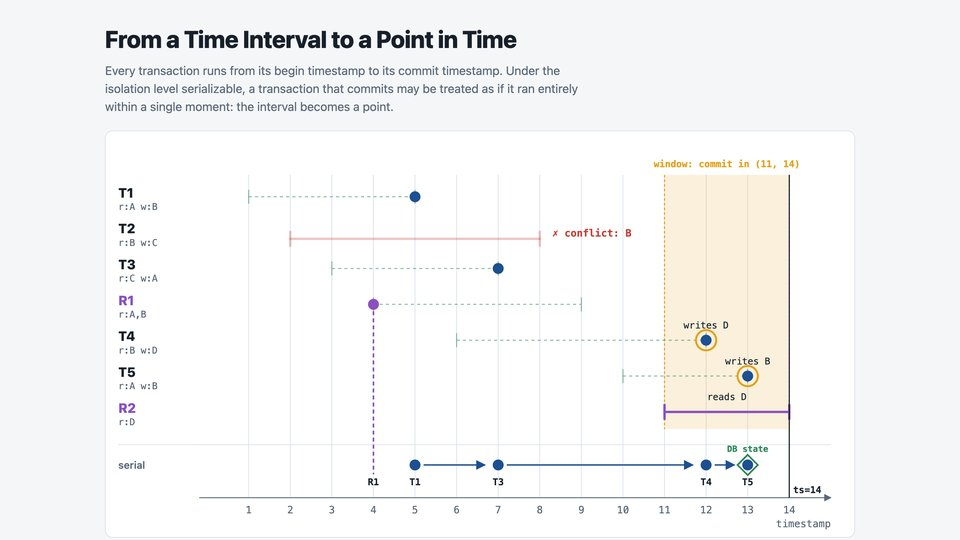
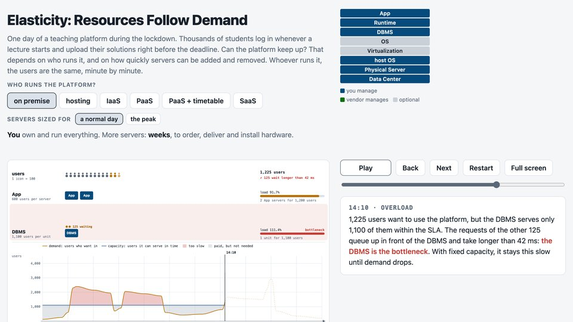
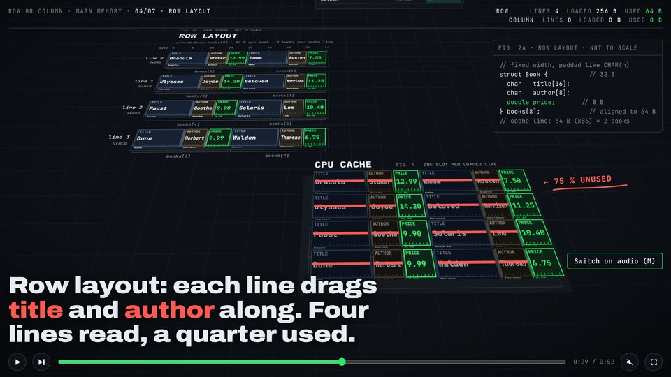
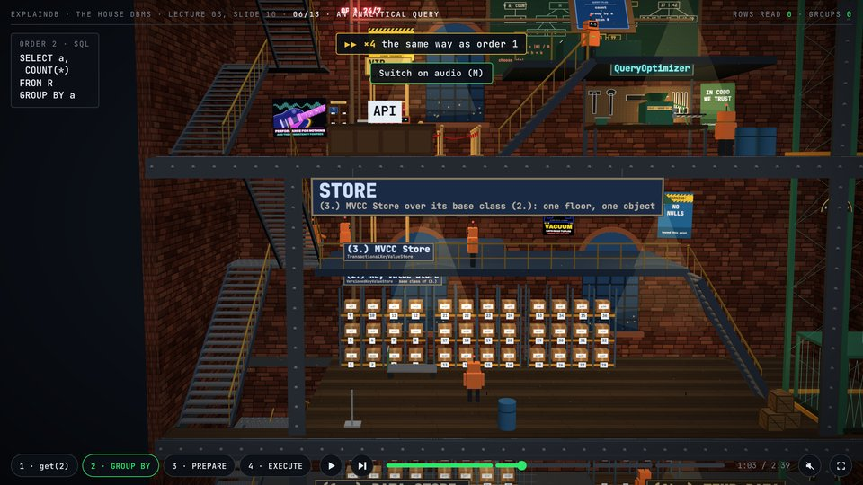
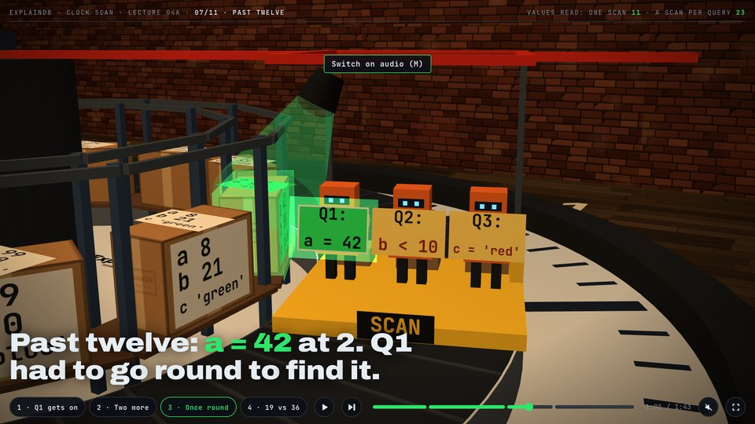
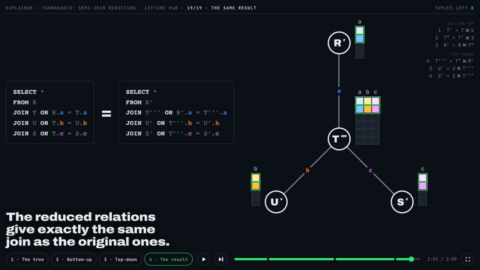

# ExplainDB - a Database System built for Understandability

[](LICENSE)
[](https://www.python.org/downloads/)
[](https://github.com/astral-sh/uv)
[](https://github.com/psf/black)
[](notebooks/)
[](https://github.com/explaindb/explaindb/commits/main)
[](https://github.com/explaindb/explaindb)
[](https://mybinder.org/v2/gh/explaindb/explaindb/main?urlpath=lab/tree/notebooks)

Teaching materials for a database systems course: a collection of Jupyter notebooks and a didactic
DBMS implemented in Python (the `system/` package). The lecture that uses this code is available on
YouTube: [Database Systems 2024/25](https://www.youtube.com/playlist?list=PLC4UZxBVGKteZpmLGukzu2BpNDifaTe9G)
(Prof. Dr. Jens Dittrich, Big Data Analytics Group, Saarland University).

## What's Inside the `system/` Package

A small DBMS written for reading, not for speed. Interfaces in
[`system/interfaces/`](system/interfaces) carry the contracts; the other folders implement them:

- **Storage** ([`storage/`](system/storage)): the storage hierarchy (DRAM, caches, SSD, disk) and RAID
  block assignment (RAID 0/1/4/5) with a reliability and performance cost model.
- **Indexes** ([`indexes/`](system/indexes)): B⁺-tree, bitmap indexes (equality- and range-encoded),
  Bloom filters, radix tries and the "Christmas tree" (a radix trie with node buffers).
- **Bit sequences** ([`indexes/bit_sequences.py`](system/indexes/bit_sequences.py)): plain and WAH-compressed bit
  sequences used by the bitmap indexes.
- **Transactional stores** ([`stores/`](system/stores)): a versioned key-value store and MVCC
  (multi-version concurrency control) with journaling, also with an index.
- **Query processing** ([`query_processing/`](system/query_processing)): operators such as scan,
  filter, hash join, semi-join and count, plus WHERE-clause predicates.
- **Sorting and queues** ([`query_processing/sorting.py`](system/query_processing/sorting.py),
  [`query_processing/queues/`](system/query_processing/queues)): external merge sort with in-memory and
  disk-backed queues.
- **Query optimization** ([`query_optimization/`](system/query_optimization)): join graphs (chain,
  star, cycle, clique), cardinality estimation, the C_out cost function, plan tables and the
  dynamic-programming join-order enumeration algorithms DPsize, DPsub and DPccp.

[`DBMS.py`](system/DBMS.py) ties these parts together: it manages stores, prepared queries and query
optimization. Unit tests for all of this live in [`system/tests/`](system/tests).

An AI-generated port of the store core to Rust, in progress, lives in [`generated/rust/`](generated/rust): a language
model generates it from the Python code (change the Python, then regenerate), with the Python names where Rust's
naming rules allow and Rust versions of the Python tests of the ported parts; see
[`generated/rust/README.md`](generated/rust/README.md), which also explains the benchmarks that compare both stores
([`benchmarks/`](benchmarks)).

## Visualizations

Standalone animations in [`visualizations/`](visualizations).

### [validation-interval-to-point](https://htmlpreview.github.io/?https://github.com/explaindb/explaindb/blob/main/visualizations/validation-interval-to-point.html)

[](https://htmlpreview.github.io/?https://github.com/explaindb/explaindb/blob/main/visualizations/validation-interval-to-point.html)

MVCC validation under the isolation level serializable: a transaction that passes validation shrinks from its interval
[begin, commit] to a single point in time, a read-only transaction to its begin; the points form an equivalent serial
schedule.

Notebook: [MVCC-Playground](notebooks/MVCC-Playground.ipynb)
[](https://mybinder.org/v2/gh/explaindb/explaindb/main?urlpath=lab/tree/notebooks/MVCC-Playground.ipynb)

### [elasticity-resources-follow-demand](https://htmlpreview.github.io/?https://github.com/explaindb/explaindb/blob/main/visualizations/elasticity-resources-follow-demand.html)

[](https://htmlpreview.github.io/?https://github.com/explaindb/explaindb/blob/main/visualizations/elasticity-resources-follow-demand.html)

Elasticity: one day of a teaching platform with the tiers App (scales out) and DBMS (scales up), run on premise, with
hosting, IaaS, PaaS (also with scheduled scaling by a timetable) or SaaS; shows bottlenecks, scale-up and scale-out, and
whether the capacity follows the demand.

### [row-or-column](https://htmlpreview.github.io/?https://github.com/explaindb/explaindb/blob/main/visualizations/row-or-column.html)

[](https://htmlpreview.github.io/?https://github.com/explaindb/explaindb/blob/main/visualizations/row-or-column.html)

Row vs. column layout in main memory: eight books stored row by row and column by column; memory is read linearly, one
64-byte cache line at a time, so `SELECT MAX(price)` loads 4 cache lines of the row layout but only 1 of the column
layout (in 3D, with three.js; a synthetic voice speaks the narration once the sound is switched on).

Notebook: [Data-Layout](notebooks/Data-Layout.ipynb)
[](https://mybinder.org/v2/gh/explaindb/explaindb/main?urlpath=lab/tree/notebooks/Data-Layout.ipynb)

### [call-through-dbms](https://htmlpreview.github.io/?https://github.com/explaindb/explaindb/blob/main/visualizations/call-through-dbms.html)

[](https://htmlpreview.github.io/?https://github.com/explaindb/explaindb/blob/main/visualizations/call-through-dbms.html)

The architecture of a DBMS as a factory building in cross-section: its floors are the layers, box robots are the
components; orders go down the stairs on paper, results ride the lift up. `SELECT * FROM R WHERE id = 2` brings up one
box; `SELECT a, COUNT(*) FROM R GROUP BY a` reads every row and folds the copies into a bar chart, the only thing that
rides up to the application; a prepared query is planned once (`PREPARE q1 … WHERE id = ?`: the DBMS files the plan in a
key rack and hands back its name) and then run with a key (`EXECUTE q1 (id = 7)`): a copy of the plan goes on a VIP
ticket, and a VIP lift takes it straight down to the store (in 3D, with three.js; a synthetic voice speaks the narration
once the sound is switched on).

### [clock-scan](https://htmlpreview.github.io/?https://github.com/explaindb/explaindb/blob/main/visualizations/clock-scan.html)

[](https://htmlpreview.github.io/?https://github.com/explaindb/explaindb/blob/main/visualizations/clock-scan.html)

Clock scan, as in QPipe and Crescando: one scan runs round a key-value store laid out like a clock and never stops;
three queries on different attributes get on at any hour, ride exactly once round and get off at their hour again, so
the one scan serves them all (19 values read instead of 36 with a scan per query; in 3D, with three.js; a synthetic
voice speaks the narration once the sound is switched on).

Notebook: [Shared-Scan](notebooks/Shared-Scan.ipynb)
[](https://mybinder.org/v2/gh/explaindb/explaindb/main?urlpath=lab/tree/notebooks/Shared-Scan.ipynb)

### [yannakakis](https://htmlpreview.github.io/?https://github.com/explaindb/explaindb/blob/main/visualizations/yannakakis.html)

[](https://htmlpreview.github.io/?https://github.com/explaindb/explaindb/blob/main/visualizations/yannakakis.html)

Yannakakis' semi-join reduction on an acyclic query: the joins of R, T, U and S form a tree with root R; each relation
shows only its keys and join attributes, as colours. A semi-join sends just a column of keys along an edge; at the other
end the column is drawn out beside the rows of that relation, and a row stays only if its key is in the column.
Bottom-up (T′, T″, R′), then top-down (T′′′, U′, S′): 18 rows become 8, each one a part of the join, and the query on
the reduced relations gives the same result as on the original ones (with three.js).

Notebook: [Result-DB](notebooks/Result-DB.ipynb)
[](https://mybinder.org/v2/gh/explaindb/explaindb/main?urlpath=lab/tree/notebooks/Result-DB.ipynb)

## Notebooks

The notebooks are grouped by the chapters of the [tutorial](docs/tutorial/README.md), which explains each
topic and points to the code that implements it. The launch badge opens a notebook directly on Binder.

### Try It in the Browser

[](https://mybinder.org/v2/gh/explaindb/explaindb/main?urlpath=lab/tree/notebooks)

Click the badge to open the notebooks in JupyterLab on [mybinder.org](https://mybinder.org), with no
installation needed. The start can take a few minutes the first time, after a change to the repository,
or after a longer pause, while Binder builds the environment. Sessions are temporary: they end after a
period of inactivity, or after a few hours at most, and all your changes are lost. Download any notebook
you want to keep (**File → Download**). mybinder.org is a free public service: do not upload private or
confidential data, and do not enter passwords in a Binder session.

### Storage & Data Layout

| Notebook | Topic | Launch |
|---|---|---|
| [Data-Layout](notebooks/Data-Layout.ipynb) | Row vs. column layout: how much each layout has to read for different queries | [](https://mybinder.org/v2/gh/explaindb/explaindb/main?urlpath=lab/tree/notebooks/Data-Layout.ipynb) |
| [MVCC-Playground](notebooks/MVCC-Playground.ipynb) | Building schedules of transactions by clicking and running them operation by operation on the MVCC store, serializable, under snapshot isolation or without validation | [](https://mybinder.org/v2/gh/explaindb/explaindb/main?urlpath=lab/tree/notebooks/MVCC-Playground.ipynb) |
| [RAID-Nesting-Trade-offs](notebooks/RAID-Nesting-Trade-offs.ipynb) | Nesting RAID 0 arrays and its effect on sequential read performance | [](https://mybinder.org/v2/gh/explaindb/explaindb/main?urlpath=lab/tree/notebooks/RAID-Nesting-Trade-offs.ipynb) |

### Indexing

| Notebook | Topic | Launch |
|---|---|---|
| [B-tree](notebooks/B-tree.ipynb) | Building a B⁺-tree step by step, with visualized splits and leaf chain | [](https://mybinder.org/v2/gh/explaindb/explaindb/main?urlpath=lab/tree/notebooks/B-tree.ipynb) |
| [Bitmaps-and-Bloom-Filters](notebooks/Bitmaps-and-Bloom-Filters.ipynb) | Bitmap indexes, their compression (WAH), and Bloom filters for fast "is this value present?" checks | [](https://mybinder.org/v2/gh/explaindb/explaindb/main?urlpath=lab/tree/notebooks/Bitmaps-and-Bloom-Filters.ipynb) |
| [Bit-Sequences-in-Pandas](notebooks/Bit-Sequences-in-Pandas.ipynb) | Boolean masks in pandas as bit sequences: filtering rows and combining masks with AND | [](https://mybinder.org/v2/gh/explaindb/explaindb/main?urlpath=lab/tree/notebooks/Bit-Sequences-in-Pandas.ipynb) |
| [Christmas-Tree](notebooks/Christmas-Tree.ipynb) | Radix and descriptor tries, with buffered and "crystal ball" variants | [](https://mybinder.org/v2/gh/explaindb/explaindb/main?urlpath=lab/tree/notebooks/Christmas-Tree.ipynb) |
| [Recursive-Model-Index](notebooks/Recursive-Model-Index.ipynb) | A learned index (RMI) for searching sorted data | [](https://mybinder.org/v2/gh/explaindb/explaindb/main?urlpath=lab/tree/notebooks/Recursive-Model-Index.ipynb) |

### Query Processing

| Notebook | Topic | Launch |
|---|---|---|
| [Result-DB](notebooks/Result-DB.ipynb) | Running a query with two joins as a pipeline of operators (push model) | [](https://mybinder.org/v2/gh/explaindb/explaindb/main?urlpath=lab/tree/notebooks/Result-DB.ipynb) |
| [CodeGen](notebooks/CodeGen.ipynb) | Generating Python code for the Result-DB query and running it | [](https://mybinder.org/v2/gh/explaindb/explaindb/main?urlpath=lab/tree/notebooks/CodeGen.ipynb) |
| [Shared-Scan](notebooks/Shared-Scan.ipynb) | Several concurrent queries sharing one pass over the data | [](https://mybinder.org/v2/gh/explaindb/explaindb/main?urlpath=lab/tree/notebooks/Shared-Scan.ipynb) |
| [External-Merge-Sort](notebooks/External-Merge-Sort.ipynb) | Sorting data larger than main memory: sort chunks, then merge them | [](https://mybinder.org/v2/gh/explaindb/explaindb/main?urlpath=lab/tree/notebooks/External-Merge-Sort.ipynb) |
| [Top-k](notebooks/Top-k.ipynb) | `ORDER BY title LIMIT 10` without sorting all rows | [](https://mybinder.org/v2/gh/explaindb/explaindb/main?urlpath=lab/tree/notebooks/Top-k.ipynb) |
| [Online-Aggregation](notebooks/Online-Aggregation.ipynb) | A running estimate of an aggregate before the scan completes | [](https://mybinder.org/v2/gh/explaindb/explaindb/main?urlpath=lab/tree/notebooks/Online-Aggregation.ipynb) |

### Query Optimization

| Notebook | Topic | Launch |
|---|---|---|
| [PlanEnumeration](notebooks/PlanEnumeration.ipynb) | Join-order enumeration algorithms (DPsize, DPsub, DPccp) | [](https://mybinder.org/v2/gh/explaindb/explaindb/main?urlpath=lab/tree/notebooks/PlanEnumeration.ipynb) |
| [Distributed-Joins](notebooks/Distributed-Joins.ipynb) | Executing a join across several nodes | [](https://mybinder.org/v2/gh/explaindb/explaindb/main?urlpath=lab/tree/notebooks/Distributed-Joins.ipynb) |

### Multidimensional

| Notebook | Topic | Launch |
|---|---|---|
| [Z-Order-Curve](notebooks/Z-Order-Curve.ipynb) | Z-codes (Morton codes): mapping 2-D data to 1-D while preserving locality | [](https://mybinder.org/v2/gh/explaindb/explaindb/main?urlpath=lab/tree/notebooks/Z-Order-Curve.ipynb) |

## Setting Up the Environment with uv

This repository uses [uv](https://docs.astral.sh/uv/) to manage its Python version and dependencies.
uv installs the correct Python interpreter for you, so no separate Python installation is required.

### 1. Install uv

- **macOS/Linux**:
    ```sh
    curl -LsSf https://astral.sh/uv/install.sh | sh
    ```
- **Windows** (PowerShell):
    ```sh
    powershell -ExecutionPolicy ByPass -c "irm https://astral.sh/uv/install.ps1 | iex"
    ```

See the [uv installation docs](https://docs.astral.sh/uv/getting-started/installation/) for
alternatives (Homebrew, pipx, etc.).

### 2. Clone the Repository

```sh
git clone https://github.com/explaindb/explaindb.git
cd explaindb
```

### 3. Install Dependencies

```sh
uv sync
```

This creates a virtual environment in `.venv/`, installs Python 3.12 if needed, and installs all
required packages from `uv.lock`.

### 4. Run Jupyter Notebook

```sh
uv run jupyter notebook
```

This opens a browser window listing the files in the current directory. The notebooks live in the
`notebooks/` directory; open them from there. Any command can be run inside the project environment by
prefixing it with `uv run` — no manual environment activation needed.

Alternatively, you may run the notebooks in an IDE like
[PyCharm](https://www.jetbrains.com/pycharm/); point its interpreter at the `.venv/` created by uv.

## Running the Tests

```sh
uv run python -m unittest discover system/tests/
```

## API Documentation

The API documentation, generated from the source docstrings, is available online at
<https://bigdata.uni-saarland.de/software/explaindb/index.html>. How to build it locally is described in
[CONTRIBUTING.md](CONTRIBUTING.md#api-documentation).

## Contributing

See [CONTRIBUTING.md](CONTRIBUTING.md) for the code formatting, the docstring conventions, and how
dependencies, notebooks and the API documentation are maintained.

## License

ExplainDB is licensed under the [GNU Affero General Public License v3.0](LICENSE) (AGPL-3.0).
Copyright (C) 2026 Prof. Dr. Jens Dittrich, Saarland University.

The pages `visualizations/row-or-column.html`, `visualizations/call-through-dbms.html`,
`visualizations/clock-scan.html` and `visualizations/yannakakis.html` also embed third-party code and fonts under their
own licenses: three.js (MIT License) and the fonts Archivo and JetBrains Mono (SIL Open Font License 1.1). Each page
gives their copyright and license notices. The first three pages also embed a synthetic voice, spoken with the model
Ming-3.0-tts (MIT License, voice UK_George); each page names it.

## Contributors

People, in order of number of commits:

- [Jens Dittrich](https://bigdata.uni-saarland.de/people/jensdittrich.html)
- [Marcel Maltry](https://bigdata.uni-saarland.de/people/marcelmaltry.html)
- [Simon Rink](https://bigdata.uni-saarland.de/people/simonrink.html)
- [Luca Gretscher](https://bigdata.uni-saarland.de/people/lucagretscher.html)
- [Joris Nix](https://bigdata.uni-saarland.de/people/jorisnix.html)
- [Su Yılmaz](https://bigdata.uni-saarland.de/people/suyilmaz.html)

With help from [Claude](https://claude.com/claude-code), an AI coding assistant by Anthropic, credited as
co-author on commits.
